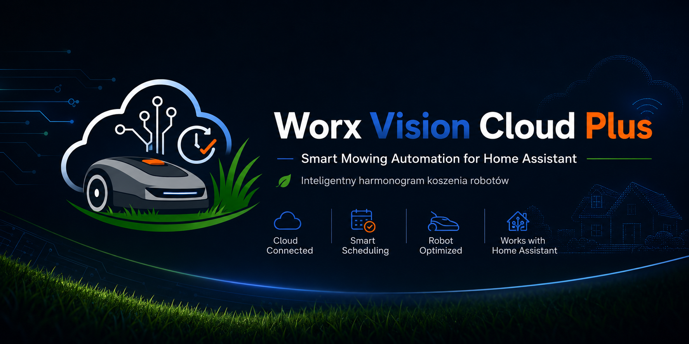

<p align="center">
  
</p>

Intelligente Mähautomatisierung für Worx-Mähroboter in Home Assistant, ausgelegt auf Worx Vision / RTK und weiterhin geeignet für ältere Worx-Modelle mit Begrenzungsdraht.

Der Blueprint ersetzt einen starren Mähplan durch einen wetterabhängigen Zeitplan. Er schätzt das Graswachstum, wählt ein trockenes und sinnvolles Mähfenster, startet zuerst den Kantenschnitt und danach das normale Mähen, sobald der Mähroboter zur Ladestation zurückgekehrt und aufgeladen ist. Vision / RTK-Mähroboter werden über automatisches Nachladen und Fortsetzen hinweg begleitet, bis sie wirklich fertig sind; ältere Modelle mit Begrenzungsdraht nutzen eine berechnete Mähdauer.

Dieses Repository ist absichtlich von der Integration getrennt:

- der Code der Integration liegt in [`worx_vision_cloud_plus_github`](https://github.com/SmartServicePL/worx_vision_cloud_plus_github),
- Automatisierungen und Blueprints liegen hier.

Erstellt von **Smart Service**.

## Blueprint importieren

Der Blueprint ist in drei Sprachen verfügbar. Alle arbeiten gleich; nur die Texte im Home-Assistant-Editor und in den Benachrichtigungen unterscheiden sich.

| Sprache | Import |
| --- | --- |
| Deutsch | [](https://my.home-assistant.io/redirect/blueprint_import/?blueprint_url=https%3A%2F%2Fgithub.com%2FSmartServicePL%2Fworx_vision_cloud_plus_automation%2Fblob%2Fmain%2Fblueprints%2Fautomation%2Fworx_vision_cloud_plus%2Fsmart_mowing_schedule_de.yaml) |
| English | [](https://my.home-assistant.io/redirect/blueprint_import/?blueprint_url=https%3A%2F%2Fgithub.com%2FSmartServicePL%2Fworx_vision_cloud_plus_automation%2Fblob%2Fmain%2Fblueprints%2Fautomation%2Fworx_vision_cloud_plus%2Fsmart_mowing_schedule_en.yaml) |
| Polski | [](https://my.home-assistant.io/redirect/blueprint_import/?blueprint_url=https%3A%2F%2Fgithub.com%2FSmartServicePL%2Fworx_vision_cloud_plus_automation%2Fblob%2Fmain%2Fblueprints%2Fautomation%2Fworx_vision_cloud_plus%2Fsmart_mowing_schedule.yaml) |

Import-URL für den manuellen Import:

```text
https://github.com/SmartServicePL/worx_vision_cloud_plus_automation/blob/main/blueprints/automation/worx_vision_cloud_plus/smart_mowing_schedule_de.yaml
```

Sprache später wechseln: die andere Datei importieren, die Automatisierung öffnen, **In YAML bearbeiten** wählen und `use_blueprint.path` auf den neuen Dateinamen ändern (zum Beispiel `SmartServicePL/smart_mowing_schedule_de.yaml`). Eingaben, Helfer und Verhalten sind in allen drei Dateien gleich, die Eingaben bleiben also erhalten.

## Was der Blueprint macht

- Schätzt das Graswachstum einmal täglich mit einem Growth-Potential-Modell (GP), das die Bedingungen des ganzen kommenden Tages nutzt (mittlere Temperatur, höchster UV-Index und Regen aus der stündlichen Vorhersage) statt eines einzelnen Messwerts am Morgen.
- Nutzt lokale Werte für Regen, Temperatur, Sonne/UV, optional Luftfeuchte und Bodenfeuchte sowie Einstellungen für Bewässerung und Düngung.
- Akzeptiert eine separate, optionale `weather`-Entität für die stündliche Planung.
- Wählt die beste Mähzeit im gewählten Zeitfenster und meidet Regen, nasses Gras und ungeeignete Temperaturen in den folgenden drei Stunden.
- Erkennt Tau über den Abstand zum Taupunkt: Das Gras gilt erst als trocken, wenn die Luft mindestens `2,5 °C` wärmer als ihr Taupunkt ist, sowohl beim Start als auch in der Vorhersage.
- Meldet einen festsitzenden oder gestörten Mähroboter innerhalb von etwa fünf Minuten während eines Zyklus, mit dem Namen des Fehlers.
- Startet zuerst den Kantenschnitt, wartet auf die Rückkehr zur Ladestation und das Aufladen auf mindestens `80 %` und startet dann das normale einmalige Mähen.
- Unterstützt beide Zyklusarten: Vision / RTK (der Mähroboter beendet die Fläche selbst) und ältere Modelle mit Begrenzungsdraht (berechnete Mähdauer).
- Hält drei Helfer aktuell: geschätztes Graswachstum, letztes vollständiges Mähen und nächstes geplantes Mähen.
- Erkennt in der WORX-App gestartetes Mähen und setzt das Graswachstum erst zurück, wenn der ganze Zyklus bestätigt ist.
- Wertet einen Lauf, den der Mähroboter nach einem kurzen Fehler abbricht und zur Ladestation zurückkehrt, als unterbrochen statt als beendet.
- Übernimmt einen laufenden Zyklus nach einem Neustart von Home Assistant oder dem Neuladen der Automatisierungen, sodass das Mähen einmal erfasst und nicht am selben Tag ein zweites Mal gestartet wird.
- Behebt einen hängenden Cloud-Status: Zeigt die Worx Cloud weiter Mähen oder Rückkehr (zum Beispiel 104 `searching home`), obwohl RTK den Mähroboter seit fünf Minuten an der Station sieht, sendet der Blueprint eine Minute Mähen und die Rückkehr zur Ladestation, damit der Mähroboter seinen echten Zustand meldet – höchstens alle zwei Stunden und mit Benachrichtigung. Ein Rückkehrbefehl wird nie an einen Mähroboter in der Ladestation gesendet.
- Optional und standardmäßig aus: Mähen nur an gewählten Wochentagen, nur bei Tageslicht (Igelschutz), Pause, wenn jemand im Garten ist, und eigene Benachrichtigungsaktionen für das Handy.
- Prüft vor dem normalen Mähen nach dem Kantenschnitt erneut Messwerte, die Regenverzögerung der Worx Cloud und die stündliche Vorhersage.

## Mählogik

Die automatische Startschwelle ist auf Mähroboter abgestimmt. Statt auf hohes Gras zu warten, bevorzugt der Blueprint häufige, leichte Schnitte, meist bei etwa `2-4,5 mm` geschätztem Wachstum je nach Schnitthöhe. Die Ein-Drittel-Regel bleibt als Sicherheitsgrenze erhalten, ist aber nicht das normale Ziel.

Jede Mähzeit kommt aus demselben Planer: die tägliche Wachstumsberechnung, ein blockierter Start, ein unterbrochener Zyklus, ein beendeter Zyklus und manuelles Mähen nutzen dieselbe Berechnung, daher zeigt jede Benachrichtigung genau die Zeit, die im Helfer gespeichert ist. Das gewählte Zeitfenster darf keinen vorhergesagten Regen haben und muss Temperatur und Luftfeuchte während der erwarteten Mähdauer im sicheren Bereich halten. Eine für heute geplante Zeit wird durch spätere Vorhersageänderungen nicht verschoben; eine Zeit an einem späteren Tag wird bei der nächsten täglichen Berechnung mit frischer Vorhersage neu bewertet. Standardmäßig wird nur zwischen `10 °C` und `25 °C` gemäht. Ist es zu heiß, sucht der Blueprint zuerst die nächste kühlere Zeit am selben Tag. Ohne FiatLux sucht er bis `22:00`, mit bestätigtem Zubehör auch nachts bis `05:00`.

Für die besten lokalen Entscheidungen eignen sich eine eigene Wetterstation oder lokale Außensensoren. Für die stündliche Vorhersage eignet sich jede `weather`-Entität in Home Assistant mit stündlicher Vorhersage, zum Beispiel `weather.forecast_home` aus der eingebauten Integration Met.no oder Tomorrow.io. Üblich ist die Vorhersage aus Home Assistant plus optional eine Wetterstation für Temperatur, Regen, Luftfeuchte und UV. Ohne stündliche Vorhersage nutzt der Blueprint das eingestellte Mähfenster und prüft die aktuellen Bedingungen beim Start.

Zur Startzeit hat ein funktionierender binärer Regensensor Vorrang: Ist er trocken, beginnt der Zyklus, auch wenn sich die Vorhersage seit der Planung geändert hat. Meldet er während des Kantenschnitts oder des Mähens Regen, fährt der Mähroboter zur Ladestation. Ist der Regensensor nicht verfügbar, dient der Zustand der Wetter-Entität (zum Beispiel `rainy`) als Ersatz. Die Abtrockenzeit nach Regen (3 Stunden, nach starkem Regen 6 Stunden) zählt ab dem Moment, in dem der Regensensor trocken meldet, und nur wenn seit Mitternacht mindestens `0,2 mm` Regen gemessen wurden.

Verhindert echter Regen, nasses Gras, eine ungeeignete Temperatur oder der Zustand des Mähroboters den Start, oder wird der Zyklus unterbrochen, plant der Blueprint ab diesem Moment eine neue konkrete Zeit und nennt den Grund in der Benachrichtigung. Benachrichtigungen gibt es nur für die tägliche Wachstumsberechnung, eine echte Verschiebung beim Start, den Start sowie das Ende oder die Unterbrechung des Mähens. Sie sind kurz: ein bestätigter `Mähtermin`, wenn die Vorhersage gute Bedingungen bestätigt, sonst die `Nächste Prüfung` mit einem Satz zum Grund. Liegt ein bestätigter Termin außerhalb des bevorzugten Zeitfensters, nennt die Benachrichtigung auch den Grund dafür.

## Vor dem Start

Deaktiviere den Mähplan in der WORX-App, damit Home Assistant als einziger Zeitplan Mähstarts auslöst.

Lege vor dem Erstellen der Automatisierung drei Helfer an:

- `input_number` für das geschätzte Graswachstum, zum Beispiel `input_number.worx_estimated_grass_growth_mm`.
- `input_datetime` für das letzte vollständige Mähen, zum Beispiel `input_datetime.worx_last_full_mow`.
- `input_datetime` für das nächste geplante Mähen, zum Beispiel `input_datetime.worx_next_planned_mow`.

Dokumentation (Englisch):

- [Einrichtung des intelligenten Mähens](docs/smart-mowing-schedule.md)
- [Beispielpaket für die Helfer](docs/smart-mowing-helpers-package.yaml)

## Voraussetzungen

- Home Assistant 2025.4.0 oder neuer.
- Integration Worx Vision Cloud PLUS `1.3.1` oder neuer aus [`SmartServicePL/worx_vision_cloud_plus_github`](https://github.com/SmartServicePL/worx_vision_cloud_plus_github).
- Eine `lawn_mower`-Entität für den Mähroboter.
- Der Dienst für einmaliges Mähen aus der Integration Worx Vision Cloud PLUS.
- Akku- und Regen-Entitäten aus der Integration.
- Quellen für Temperatur, Regen/Wetter und Sonne/UV in Home Assistant.
- Drei Helfer: geschätztes Graswachstum, letztes vollständiges Mähen, nächstes geplantes Mähen.
- Optional ein Bodenfeuchtesensor.

## Übersetzungen

Die polnische Datei `smart_mowing_schedule.yaml` ist die Quelle. Die englische und die deutsche Datei werden daraus mit [`tools/blueprint_i18n.py`](tools/blueprint_i18n.py) und dem Textkatalog [`i18n/smart_mowing_schedule.yaml`](i18n/smart_mowing_schedule.yaml) erzeugt. Korrekturen an einer Übersetzung gehören in den Katalog, nicht in die erzeugten Dateien. Details stehen in der [englischen README](README.md#translations).

## Unterstützung

Wenn dir das Projekt hilft, kannst du Smart Service unterstützen:

[Spenden über Revolut](https://revolut.me/smartserwis)

## Datenschutz

Veröffentliche keine Speicherdateien von Home Assistant, Zugriffstoken, Seriennummern, rohe API-Antworten oder Screenshots mit genauen Gartenkoordinaten.
